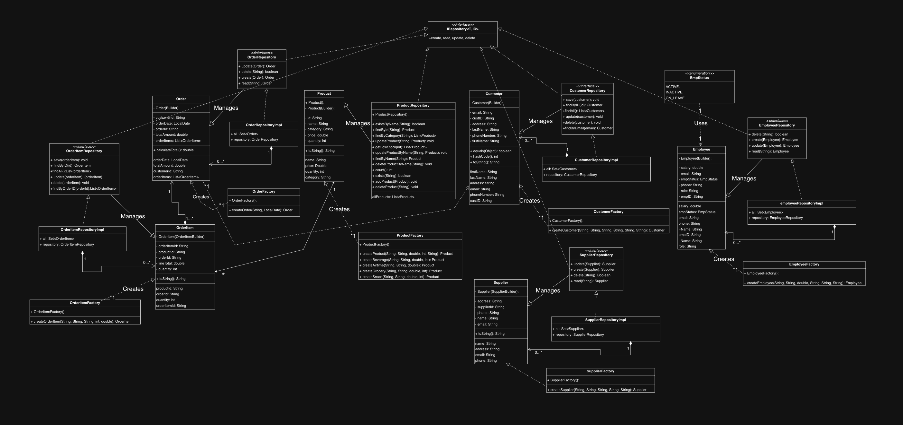

# Nexus – Wholesale Manager

Resource management for a small wholesaler: products & stock, sales (point of sale), customers,
suppliers and employees (leave + clock in/out), with notifications. Spring Boot + MySQL backend,
React (Vite) frontend.

## Run it locally

**You need:** MySQL running locally (user `root` / password `password`, change in
`src/main/resources/application.properties`), Java 21, Node 18+.
The `Capstone` database is created automatically.

### Option A – one click from IntelliJ (no Node needed)
1. Run `AdpAssignment02Application`.
2. Open **http://localhost:8080/adp-assignment/**

Spring Boot serves the built React app from `src/main/resources/static`.
After changing frontend code, run `npm run build` inside `frontend/` to refresh it.

### Option B – development (live reload), start in any order
1. Backend: run `AdpAssignment02Application` in IntelliJ (or `./mvnw spring-boot:run`).
2. Frontend: `cd frontend` → `npm install` (first time) → `npm run dev`
3. Open **http://localhost:5173/adp-assignment/**

The Vite dev server proxies all API calls to port 8080, so there are no CORS problems and the
order doesn't matter. If the backend isn't up yet, the app shows "waiting for server" and
reconnects automatically.

### Option C – both with one command
`cd frontend` → `npm run dev:all` (starts Spring Boot and Vite together; Ctrl+C stops both).

## First login
On first start the backend creates an admin account (also printed in the IntelliJ console):

| Role  | Email                    | Password    |
|-------|--------------------------|-------------|
| Admin | `admin@wholesale.local`  | `Admin@123` |

If the database is completely empty, sample data and a sample employee
(`lerato@wholesale.local` / `Staff@123`) are added too. Turn that off with
`app.seed-demo-data=false`. Employees that existed before logins were added can sign in with
`Welcome@123`. Change passwords under **My Profile**.

## What's new
- **IDs are automatic** – CUS-0001, EMP-0001, PRD-0001, SUP-0001, ORD-0001 … (stored in the `id_sequence` table).
- **Search by name everywhere**, with live suggestions. Switch the dropdown to **ID** to search by ID.
- **New Sale (POS)** – pick or add the customer, add products by name, see unit prices, line totals and the grand total; stock is reduced automatically; printable receipt.
- **Pictures** for products, customers, suppliers and employees (resized in the browser, stored in the DB).
- **Admin vs Employee** areas, enforced by Spring Security – admins manage people, stock and leave; employees sell, check stock, request leave and clock in/out.
- **Notifications** – low/out of stock, inactive customers (30+ days), leave requests/decisions, clock in/out, new sales. Stock and customers are checked every hour.

## New API endpoints (all under `/adp-assignment`)
| Method | Path | Purpose |
|---|---|---|
| POST | `/orders/checkout` | `{customerId, employeeId, items:[{productId, quantity}]}` – complete a sale |
| GET | `/{customers\|employees\|products\|suppliers}/search?name=` | search by name |
| GET | `/customers/{id}/orders` | a customer's orders |
| PUT | `/products/{id}/restock?amount=` | add stock |
| GET | `/products/low-stock` | products at/below re-order level |
| POST | `/auth/login` (form: `email`, `password`, `remember-me`), `/auth/logout` | Spring Security login / logout |
| GET/PUT | `/auth/me` | the logged-in employee / update own phone & photo |
| POST | `/auth/change-password` | change own password |
| POST/PUT/GET | `/leave/request`, `/leave/{id}/approve`, `/leave/{id}/decline`, `/leave/{id}/cancel`, `/leave/all`, `/leave/employee/{id}` | leave |
| POST/GET | `/attendance/clock-in/{id}`, `/attendance/clock-out/{id}`, `/attendance/current/{id}`, `/attendance/all` | clock in/out |
| GET/PUT/POST | `/notifications?employeeId=&accessLevel=`, `/notifications/{id}/read`, `/notifications/read-all`, `/notifications/run-checks` | notifications |
| GET | `/health` | is the backend up? |

The original `create / read / update / delete / all` endpoints still work; leave the ID empty on
`create` and it is generated.

## Security (Spring Security)
Built from the Blackboard *Security* notes (Chapter 9.6–9.7), using modern Java configuration
(`security/SecurityConfig.java`) instead of `applicationContext-security.xml`:

| Notes (XML) | This project |
|---|---|
| `<form-login>` | Form login: the React login screen posts `email` + `password` to `/auth/login` |
| Users / Roles tables + `jdbc-user-service` | `EmployeeUserDetailsService` – employees are the users; **ROLE_ADMIN** / **ROLE_EMPLOYEE** come from *App access* |
| `<password-encoder hash="md5"/>` | `BCryptPasswordEncoder` (MD5 is no longer considered safe) |
| `<intercept-url pattern access="ROLE_…">` | URL rules in `SecurityConfig` (see below) |
| `<global-method-security pre-post-annotations>` | `@EnableMethodSecurity` + `@PreAuthorize("hasRole('ADMIN')")` on admin-only controllers/methods |
| remember-me checkbox | "Keep me signed in" on the login screen (`remember-me` cookie, 14 days) |
| session-fixation protection | `migrateSession` |
| `SecurityContextHolder` (current user) | `security/CurrentUser.java` – employees can only see/change **their own** leave, shifts and notifications |
| accessDenied.jsp | JSON messages (401 *Please sign in*, 403 *You don't have permission…*) shown in the app |

**Who can do what**

| | Admin | Employee |
|---|---|---|
| Dashboard, view products / customers / suppliers / orders | ✔ | ✔ |
| New Sale (and add a customer during a sale) | ✔ | ✔ |
| Request leave, clock in/out, own profile & password | ✔ | ✔ (own records only) |
| Add / edit / delete products, suppliers, customers, orders | ✔ | ✘ |
| Employees page, approve/decline leave, attendance register | ✔ | ✘ |

CSRF protection is on: the token is kept in the `XSRF-TOKEN` cookie and the React app sends it in
the `X-XSRF-TOKEN` header automatically.

## Tests
`mvn test` (or right-click `src/test/java` → *Run All Tests* in IntelliJ). Tests use an in-memory
**H2** database (`src/test/resources/application.properties`), so MySQL doesn't need to be running.
They cover domain classes, factories, services (Mockito), controllers, repository queries and the
security rules (`SecurityConfigTest`).
